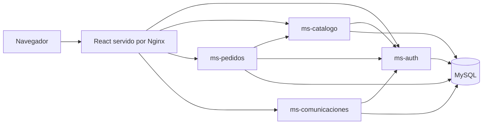

# Jarodandre · Joyería urbana

Frontend de una tienda de anillos, cadenas, collares y grillz, con catálogo, blog, compra como invitado o cliente y panel administrativo. Los datos de negocio se consultan y actualizan mediante cuatro microservicios Spring Boot que persisten en MySQL.

## Repositorios y arquitectura local

| Repositorio | Contenido |
| --- | --- |
| [ja-joyeria](https://github.com/pablophdev/ja-joyeria) | React, componentes, estilos, cliente HTTP, Dockerfile del frontend y Nginx. |
| [jarodandre-backend](https://github.com/pablophdev/jarodandre-backend) | Cuatro microservicios, migraciones MySQL y Docker Compose de la tienda completa. |



Nginx entrega los archivos de React, permite recargar rutas como `/productos/3` y dirige `/api/auth`, `/api/catalogo`, `/api/pedidos` y `/api/comunicaciones` al servicio correspondiente. MySQL contiene cuatro bases, una por microservicio. La guía operativa de la base y los servicios está en el README del backend.

## Funcionalidades

- Inicio con carrusel, videos, colecciones, destacados y filtros.
- Catálogo con búsqueda, categorías, grupos, precios y ordenamiento. Fichas con imagen, descripción enriquecida, valoración y disponibilidad.
- Registro, login, expiración de sesión y permisos de administrador. Las contraseñas se verifican en el backend.
- Carrito persistido en el servidor, cantidades de 1 a 99 y checkout con datos de entrega y total verificado por pedidos.
- Pago simulado, resultado, historial, comprobantes y seguimiento de entrega. Las compras de invitados usan tokens privados.
- Administración de productos e imágenes, creación de usuarios, cambios de rol y estado, pedidos, reportes, mensajes y suscriptores.
- Blog con artículos servidos por catálogo, formulario de contacto y newsletter.

La carga inicial incluye 14 productos y 9 artículos. El entorno local habilita pagos simulados. La integración de una pasarela real sigue pendiente. El inventario actual usa disponibilidad declarada; el modelo de reservas por unidades requiere una evolución posterior.

## Tecnologías

| Tecnología | Uso |
| --- | --- |
| React 19, React Router 7, Vite 8 | Componentes, navegación SPA y compilación. |
| Bootstrap 5.3 y CSS | Formularios, disposición adaptable y estilos. |
| GSAP, ScrollTrigger y `@gsap/react` | Animaciones de la tienda y limpieza durante el ciclo de vida de React. |
| TipTap y StarterKit | Editor de descripciones de productos. |
| DOMPurify | Limpieza del HTML de las descripciones antes de enviarlo y al mostrarlo. |
| Vitest, Testing Library y ESLint | Pruebas y revisión estática. |
| Docker y Nginx | Construcción y ejecución del frontend local. |

## Ejecutar toda la tienda con Docker

Se requiere Docker Desktop con el motor Linux activo y Docker Compose v2. Clonar ambos repositorios dentro de la misma carpeta para conservar el contexto relativo de construcción.

```powershell
git clone https://github.com/pablophdev/ja-joyeria.git
git clone https://github.com/pablophdev/jarodandre-backend.git
cd jarodandre-backend
docker compose up -d --build
docker compose ps
```

La estructura esperada es:

```text
carpeta-de-trabajo/
├── ja-joyeria/
│   └── jarodandre/
│       ├── Dockerfile
│       └── nginx.conf
└── jarodandre-backend/
    └── docker-compose.yml
```

Abrir [la tienda local](http://localhost:5173). El primer arranque descarga las imágenes, compila los proyectos y aplica las migraciones. Compose espera a que los servicios necesarios estén saludables antes de iniciar el frontend.

| Acceso de desarrollo | Valor |
| --- | --- |
| Administrador | `admin@jarodandre.local` |
| Contraseña del administrador | `Admin123123` |
| MySQL desde el equipo | `127.0.0.1:3307`, usuario `ja`, contraseña `123123` |

La cuenta administrativa se crea al iniciar auth con `LOCAL_ADMIN_ENABLED=true` si ese correo aún no existe. Estas credenciales pertenecen al entorno local.

Para reconstruir el frontend después de editarlo, ejecutar desde el backend:

```powershell
docker compose up -d --build frontend
```

Para detener la tienda y conservar sus volúmenes:

```powershell
docker compose down
```

## Desarrollar con Vite

Se requiere Node.js 24 y npm. Primero iniciar MySQL y los cuatro microservicios siguiendo el README del backend. Desde este repositorio:

```powershell
cd jarodandre
npm ci
npm run dev -- --port 5173 --strictPort
```

Usar `http://localhost:5173` para coincidir con el origen CORS configurado en las APIs. El archivo [`.env.example`](./jarodandre/.env.example) enumera las URLs. Si se necesitan valores propios, copiarlo a `.env.local` y reiniciar Vite.

| Variable | Valor directo para desarrollo |
| --- | --- |
| `VITE_AUTH_URL` | `http://localhost:8081` |
| `VITE_CATALOGO_URL` | `http://localhost:8082` |
| `VITE_PEDIDOS_URL` | `http://localhost:8083` |
| `VITE_COMUNICACIONES_URL` | `http://localhost:8084` |
| `VITE_MEDIA_URL` | Opcional. Por defecto, URL de catálogo seguida de `/media`. |

Dentro de la imagen Docker, las cuatro URLs se establecen como `/api/...` durante la compilación. Las variables `VITE_` son públicas y se incorporan al JavaScript generado. Los secretos de MySQL, las claves privadas y el token de comunicación interna pertenecen al backend.

## Animaciones, editor y HTML

Los efectos de GSAP están en `src/utilidades/motion.js` y `src/utilidades/scrollReveal.js`. Cubren carrusel, tarjetas, colecciones, confirmación del carrito, checkout y resultado del pago. Respetan `prefers-reduced-motion` y limpian observadores, suscripciones y animaciones al desmontar o recargar los módulos.

El formulario administrativo de productos carga TipTap cuando se utiliza el editor. Admite párrafos, títulos, subtítulos, negrita, cursiva, listas y deshacer o rehacer. Las descripciones anteriores en texto simple siguen siendo compatibles. El HTML se guarda en `descripcion` mediante la API existente.

`src/utilidades/descriptionHtml.js` centraliza DOMPurify con una lista de etiquetas de formato permitidas. Elimina scripts, imágenes incrustadas, enlaces y atributos del HTML enriquecido. La ficha vuelve a aplicar esa limpieza antes de renderizar la descripción.

## Sesión y datos

`src/datos/api.js` concentra las solicitudes, errores, tokens y paginación. `ConexionBackend` carga identidad, catálogo, artículos y carrito antes de montar las vistas. Los demás módulos de `src/datos` adaptan los DTO del servidor a las pantallas.

La sesión y los secretos de invitado se conservan en `sessionStorage` del navegador. El carrito, las cuentas, compras, mensajes y suscripciones se guardan en MySQL a través de las APIs. Las fotografías nuevas se suben a catálogo; los recursos iniciales también forman parte del proyecto.

## Compilar y verificar

Ejecutar dentro de `jarodandre/`:

```powershell
npm run lint
npm run build
npm run test -- --run
```

`npm run preview` sirve la compilación de `dist/`. Para reproducir los endpoints `/api/...` configurados en la imagen, usar la ejecución de Nginx mediante Compose. Las pruebas cubren contratos HTTP, permisos de rutas, componentes, animaciones, editor y sanitización.

## Rutas y documentación técnica

| Rutas | Pantallas |
| --- | --- |
| `/`, `/productos`, `/productos/:productId` | Inicio, catálogo y ficha. |
| `/registro`, `/login` | Registro e inicio de sesión. |
| `/carrito`, `/checkout`, `/checkout/resultado/:orderId`, `/pedidos` | Compra e historial. |
| `/blog`, `/blog/:slug`, `/nosotros`, `/contacto` | Contenido y contacto. |
| `/admin`, `/admin/productos`, `/usuarios` | Panel, productos y usuarios. |
| `/admin/ordenes`, `/admin/reportes`, `/admin/mensajes`, `/admin/suscriptores` | Operación administrativa. |

La [guía técnica del frontend](./jarodandre/README.md) detalla su organización y los contratos de comunicación. Ante un error de carga, comprobar primero las URLs y el estado de los cuatro servicios con `docker compose ps` y `docker compose logs --tail=100` desde el backend.

## Reseñas y formularios

El administrador selecciona la categoría desde las opciones del backend. No puede asignar estrellas ni cantidades de reseñas al crear o editar productos. Los clientes con una compra pagada del producto pueden publicar o actualizar su valoración de 1 a 5 estrellas y un comentario opcional desde la ficha del producto. El backend verifica la compra y calcula el resumen de valoraciones.

Los errores de formulario muestran el campo y una explicación en español. Para registrar una cuenta, la contraseña requiere entre 8 y 72 caracteres; el teléfono es opcional.
