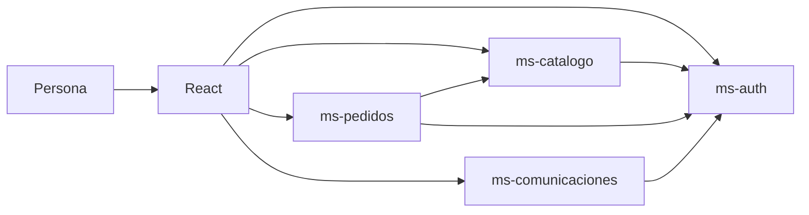

# Jarodandre: tienda en React

Este repositorio contiene la página de JA Joyería. Desde aquí se muestra el catálogo, se realizan las compras y se accede a la administración. Los datos de usuarios, productos, pedidos y mensajes se guardan en el backend, en MySQL.

## Cómo se conecta la tienda

La web está hecha con React y se comunica con cuatro servicios Spring Boot: autenticación, catálogo, pedidos y comunicaciones. El frontend se ejecuta fuera de Docker. En desarrollo usa Vite; para desplegarlo, publica `dist/` en un servidor web o hosting estático con fallback a `index.html` para las rutas de React Router.



La guía para iniciar la base y los servicios está en el [README del backend](https://github.com/pablophdev/jarodandre-backend#jarodandre-backend-y-gu%C3%ADa-para-ejecutarlo).

## Qué puedes hacer

- Ver productos, buscar por nombre, filtrar categorías y revisar los detalles.
- Crear una cuenta o iniciar sesión.
- Añadir productos al carrito y completar una compra de prueba, como invitado o con una cuenta.
- Consultar pedidos, comprobantes y estado de entrega.
- Usar la administración para gestionar productos, usuarios, pedidos, mensajes y suscripciones.
- Leer artículos del blog, enviar una consulta y registrarte para recibir novedades.
- Publicar una reseña de un producto después de pagarlo. El administrador no asigna estrellas ni reseñas: el cliente elige su valoración desde la ficha del producto.

En este entorno los pagos son simulados y el inventario utiliza la disponibilidad indicada para cada producto.

## Tecnologías principales

| Herramienta | Uso en la tienda |
| --- | --- |
| React, React Router y Vite | Pantallas, navegación y desarrollo local. |
| Bootstrap y CSS | Estilos y presentación adaptable a distintos tamaños. |
| GSAP | Animaciones de la tienda. |
| TipTap | Editor de texto enriquecido para descripciones de productos. |
| DOMPurify | Limpia el HTML de las descripciones antes de mostrarlo. |
| Hosting estático o servidor web | Publica los archivos compilados de `dist/` sin Docker. |

## Preparar el backend

Sigue la [guía del backend](https://github.com/pablophdev/jarodandre-backend#readme) para preparar MySQL externo y levantar los cuatro microservicios con Docker Compose. El frontend y MySQL no forman parte de Compose. Los repositorios pueden estar en carpetas o equipos distintos.

## Publicar sin Docker

Desde `jarodandre`, configura las variables `VITE_*` antes de ejecutar `npm ci` y `npm run build`. Publica el contenido de `dist/` en tu EC2 con un servidor web, S3 + CloudFront u otro hosting estático. Configura el servidor para devolver `index.html` en las rutas de React Router.

Las URLs de las APIs deben ser accesibles desde el navegador; no uses nombres internos de Docker. Para producción usa HTTPS y configura `FRONTEND_ORIGIN` en el backend con el origen exacto del sitio. Si usas rutas relativas `/api/...`, el servidor o balanceador debe reenviarlas a los microservicios. `npm run preview` es solo para comprobar la compilación.

## Trabajar en el frontend con Vite

Para usar el servidor de desarrollo necesitas Node.js 24 y npm. Primero inicia MySQL y los cuatro servicios siguiendo la guía del backend. Después, desde este repositorio:

```powershell
cd jarodandre
npm ci
npm run dev -- --port 5173 --strictPort
```

Abre `http://localhost:5173`. Si cambian las direcciones de las APIs, copia `.env.example` a `.env.local`, ajusta sus valores y reinicia Vite.

| Variable | Dirección local habitual |
| --- | --- |
| `VITE_AUTH_URL` | `http://localhost:8081` |
| `VITE_CATALOGO_URL` | `http://localhost:8082` |
| `VITE_PEDIDOS_URL` | `http://localhost:8083` |
| `VITE_COMUNICACIONES_URL` | `http://localhost:8084` |
| `VITE_MEDIA_URL` | Opcional. Por defecto usa el servicio de catálogo. |

Las variables que comienzan con `VITE_` se incluyen en los archivos web. No pongas contraseñas ni claves privadas en ellas.

## Reseñas, descripciones y animaciones

En la ficha de un producto aparecen las reseñas de clientes. Para publicar o actualizar una, la persona debe iniciar sesión con la cuenta asociada a una compra pagada del producto. El backend valida la compra y calcula el promedio que se muestra en la tienda.

El formulario de administración permite elegir una categoría existente de la lista. Las reseñas y estrellas se gestionan desde la ficha por los compradores.

El editor TipTap se usa para escribir las descripciones. DOMPurify limpia el HTML antes de guardarlo y volver a mostrarlo, conservando el formato permitido. GSAP anima elementos de la tienda y respeta la preferencia del sistema para reducir el movimiento.

## Dónde vive cada parte del frontend

| Carpeta | Qué contiene |
| --- | --- |
| `src/componentes` | Piezas reutilizables de las páginas, como formularios, tarjetas y navegación. |
| `src/paginas` | Pantallas completas de la tienda. |
| `src/datos` | Solicitudes al backend y adaptación de sus respuestas para la web. |
| `src/utilidades` | Funciones compartidas, como formato, limpieza de HTML y animaciones. |
| `public` y `src/assets` | Iconos e imágenes de la tienda. |

El navegador guarda la sesión y algunos tokens temporales de compras de invitado. Los productos, cuentas, pedidos, mensajes y suscripciones se guardan en el backend.

## Comprobar cambios

Desde la carpeta `jarodandre`, puedes revisar el código y crear la versión lista para servir así:

```powershell
npm run lint
npm run build
npm run test -- --run
```

`npm run preview` permite abrir la compilación de prueba. Las URLs de las APIs quedan incorporadas al compilar; vuelve a ejecutar `npm run build` si cambian.

## Páginas principales

| Dirección | Página |
| --- | --- |
| `/`, `/productos`, `/productos/:productId` | Inicio, catálogo y detalle del producto. |
| `/registro`, `/login` | Registro e inicio de sesión. |
| `/carrito`, `/checkout`, `/pedidos` | Carrito, compra e historial. |
| `/blog`, `/blog/:slug`, `/nosotros`, `/contacto` | Artículos, información y contacto. |
| `/admin`, `/admin/productos`, `/usuarios` | Panel y gestión de la tienda. |
| `/admin/ordenes`, `/admin/reportes`, `/admin/mensajes`, `/admin/suscriptores` | Pedidos, reportes, mensajes y lista de novedades. |

Si la web no carga datos, comprueba que los servicios estén iniciados con `docker compose ps` desde la carpeta del backend. Para ver el motivo de un fallo, usa `docker compose logs --tail=100 nombre-del-servicio`.

## Diseña tus grillz en 3D

La nueva página `/grillz`, accesible desde el menú, permite elegir entre 16 dientes (8 superiores y 8 inferiores), girar y acercar el modelo, elegir dorado, plateado u oro rosado y añadir piedras. Puedes aplicar un acabado a todos los dientes cubiertos o combinar acabados al añadir dientes.

La descarga JPG funciona sin iniciar sesión e incluye el diseño y una descripción. El borrador se conserva en la pestaña mientras inicias sesión. Con una cuenta puedes guardar diseños, volver a abrirlos y solicitar cotizaciones. El administrador las revisa en `/admin/grillz` y puede reconstruir la misma configuración en 3D.

El modelo actual `arcada-v2` usa geometría propia en Three.js: encías curvas, esmalte con variación de tono y formas distintas para incisivos, caninos y premolares. Los diseños anteriores conservan `arcada-v1` hasta que el cliente decide actualizarlos. No requiere descargar modelos de terceros. El visor se carga únicamente al entrar a estas páginas. Si WebGL no está disponible, la selección mediante botones continúa disponible, aunque no es posible generar el JPG.

Los importes son referencias de desarrollo que llegan del backend. El modelo representa la apariencia; la fabricación requiere confirmar el presupuesto, los materiales y el molde. No se realiza un pago al pedir una cotización.

La galería incluye siete estilos: liso, piedras, marco abierto, piedra central, colmillo, rayas grabadas y corazón. Seleccionar un estilo lo aplica a los dientes cubiertos. Todos los estilos se guardan por diente, se recuperan en administración y aparecen en el JPG. El borrador local se actualiza al modelo nuevo; los diseños guardados mantienen su versión y ofrecen un botón para actualizarla.
